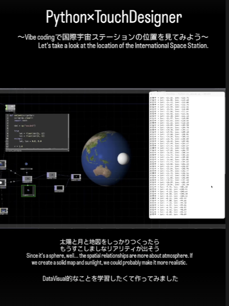

# ISS Position Real-time Visualization

A real-time visualization of the position of the International Space Station (ISS),
built with Python and TouchDesigner.

## How it works

- Python fetches the current position of the ISS
- The data is sent into TouchDesigner
- TouchDesigner renders the position in real time

## Files

- `jaxapython.png`: screenshot of the Python script
- `screenshot.png`: screenshot of the visualization

## Author

Rimi Watanabe, creative technologist (Montreal)

Portfolio: https://rimiwatworks.wixsite.com/my-site-2
